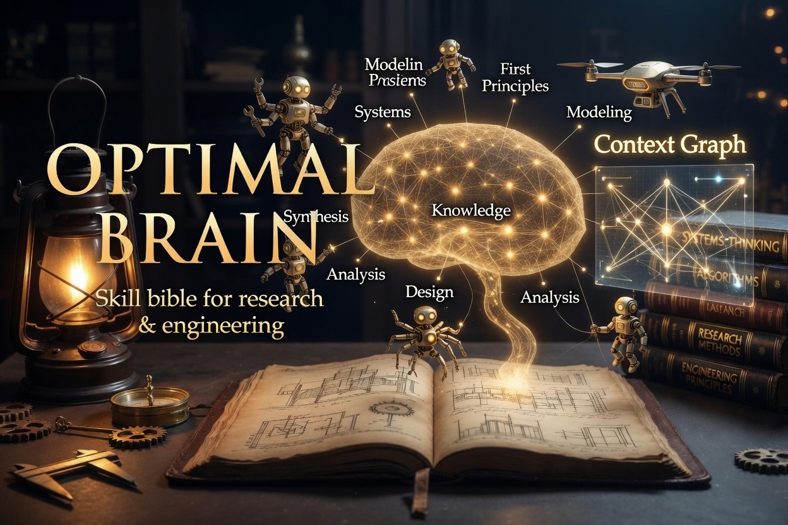
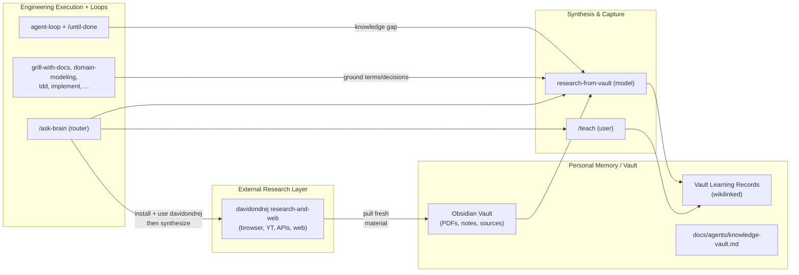

# optimal-brain

**Give your coding agent a long-term memory: every research session becomes linked, sourced Obsidian notes it reads back next time.**



optimal-brain is a skills stack for research and long-term knowledge work. It adds three layers on top of a solid engineering skill set:

1. **Vault memory**: an Obsidian vault becomes the agent's durable memory. Research is captured as sourced notes with confidence levels and supersession rules, and read back in later sessions.
2. **Loops**: goal-based agent loops (Plan → Act → Observe → Verify → Stop) with explicit, per-repo stop rules.
3. **Architect**: a system-architecture orchestrator that works across 10 competence roles and produces a session hub, ADRs, and a delivery handoff.



*Layered architecture (details in [`docs/OPTIMAL-BRAIN.md`](./docs/OPTIMAL-BRAIN.md)).*

## Credits

optimal-brain is an MIT-licensed fork of [mattpocock/skills](https://github.com/mattpocock/skills) by Matt Pocock. The engineering fundamentals (grilling, domain modeling, TDD, PRDs/issues, codebase design, `teach`, and the overall skill model) come from there. External research ingestion is designed to work with [davidondrej/skills](https://github.com/davidondrej/skills) by David Ondrej (`research-and-web`). See [LICENSE](./LICENSE) for both copyright notices.

## What's new vs mattpocock/skills

| Layer | mattpocock/skills | optimal-brain adds |
| ----- | ----------------- | ------------------ |
| Memory / second brain | None; learning stays in `teach` workspaces or chat | Obsidian vault as the durable store: `setup-knowledge-vault`, `research-from-vault` with [`RESEARCH-CAPTURE-FORMAT.md`](./skills/productivity/research-from-vault/RESEARCH-CAPTURE-FORMAT.md), `project-notes`, `vault-context-canvas`, `decision-mapping` |
| External sensing | None explicit | Recipes to ingest `davidondrej/skills` research into the vault and synthesize it |
| Autonomous iteration | No loop discipline | `setup-agent-loops`, `agent-loop` + [`STOP-RULES.md`](./skills/engineering/agent-loop/STOP-RULES.md), `/until-done`, loop recipes |
| Synthesis | `teach` (local workspace) | `teach` bridges learning records into the vault and can use vault sources |
| Architecture | Implicit | `system-architect` with 10 role briefs, engagement types, and recipes |
| Routing | `ask-matt` | `/ask-brain` with a Knowledge, Research & Learning section |

## Quick start (Lite: vault memory only)

1. Install:

   ```bash
   npx skills@latest add chidiokoene/optimal-brain
   ```

   Select at least `setup-knowledge-vault` and `research-from-vault` (add `project-notes` and `vault-context-canvas` if you like).

2. In your agent, run `/setup-knowledge-vault` and point it at your Obsidian vault.

3. Ask the agent to research something using your vault, e.g. "research X using my vault". `research-from-vault` writes linked, sourced notes back into the vault, and later sessions read them back.

**Optional layers:**

- **Loops**: install `setup-agent-loops`, `agent-loop`, `until-done`; run `/setup-agent-loops` once per repo, then `/until-done <goal>`.
- **Architect**: install `system-architect`, then `/system-architect` for discovery, as-is review, target design, or migration.
- **Engineering base**: run `/setup-optimal-brain` once per repo before `to-prd`, `to-issues`, `triage`.
- **External research**: `npx skills@latest add davidondrej/skills` and pick `research-and-web` to feed fresh material into the vault.
- Not sure where to start? Use `/ask-brain`. For a full walkthrough see [docs/PLAYBOOK.md](./docs/PLAYBOOK.md).

## Skill index

### Vault memory layer

- **[setup-knowledge-vault](./skills/productivity/setup-knowledge-vault/SKILL.md)** (user): configure vault location, learning records, PDFs, context graph, and recipes for ingestion.
- **[research-from-vault](./skills/productivity/research-from-vault/SKILL.md)** (model): research and synthesize with the vault as the primary source; captures findings per `RESEARCH-CAPTURE-FORMAT.md`.
- **[project-notes](./skills/productivity/project-notes/SKILL.md)** (user): capture personal notes under `{ProjectFolder}/Personal Notes/`.
- **[vault-context-canvas](./skills/productivity/vault-context-canvas/SKILL.md)** (user): create or refresh an Obsidian JSON Canvas context graph.
- **[decision-mapping](./skills/productivity/decision-mapping/SKILL.md)** (user): turn a loose idea into a sequenced map of investigation tickets and drive them to resolution.
- **[teach](./skills/productivity/teach/SKILL.md)** (user): multi-session teaching workspace, bridged to the vault.

### Loops layer

- **[setup-agent-loops](./skills/engineering/setup-agent-loops/SKILL.md)** (user): verification commands, stop rules, scope, starter recipes. Run once per repo.
- **[agent-loop](./skills/engineering/agent-loop/SKILL.md)** (model): Plan → Act → Observe → Verify → Stop discipline.
- **[until-done](./skills/engineering/until-done/SKILL.md)** (user): run a goal-based loop until verification passes or a stop rule fires.
- **[implement](./skills/engineering/implement/SKILL.md)** (user): implement a PRD or issue using agent-loop discipline.

### Architect layer

- **[system-architect](./skills/engineering/system-architect/SKILL.md)** (user): orchestrate architecture across up to 6 of 10 role briefs into a session hub, ADRs, and a `/to-prd` handoff.

### Router and setup

- **[ask-brain](./skills/engineering/ask-brain/SKILL.md)** (user): which skill or flow fits your situation.
- **[setup-optimal-brain](./skills/engineering/setup-optimal-brain/SKILL.md)** (user): issue tracker, triage labels, domain doc layout.

### Engineering base (from mattpocock/skills)

- User-invoked: [grill-with-docs](./skills/engineering/grill-with-docs/SKILL.md), [triage](./skills/engineering/triage/SKILL.md), [improve-codebase-architecture](./skills/engineering/improve-codebase-architecture/SKILL.md), [to-issues](./skills/engineering/to-issues/SKILL.md), [to-prd](./skills/engineering/to-prd/SKILL.md), [prototype](./skills/engineering/prototype/SKILL.md), [grill-me](./skills/productivity/grill-me/SKILL.md), [handoff](./skills/productivity/handoff/SKILL.md), [writing-great-skills](./skills/productivity/writing-great-skills/SKILL.md)
- Model-invoked: [diagnosing-bugs](./skills/engineering/diagnosing-bugs/SKILL.md), [tdd](./skills/engineering/tdd/SKILL.md), [domain-modeling](./skills/engineering/domain-modeling/SKILL.md), [codebase-design](./skills/engineering/codebase-design/SKILL.md), [grilling](./skills/productivity/grilling/SKILL.md)

### Misc (not in the plugin manifest)

- [git-guardrails-claude-code](./skills/misc/git-guardrails-claude-code/SKILL.md): Claude Code hooks that block dangerous git commands.
- [setup-pre-commit](./skills/misc/setup-pre-commit/SKILL.md): Husky + lint-staged pre-commit hooks.
- [resolving-merge-conflicts](./skills/engineering/resolving-merge-conflicts/SKILL.md): resolve an in-progress merge/rebase conflict.

User-invoked skills run when you type them (e.g. `/until-done`); model-invoked skills can also be picked up automatically by the agent when the task fits.

## Agent compatibility

Skills are plain `SKILL.md` folders (the Agent Skills format), so any agent that reads that format should be able to load them. What the repo actually backs up:

| Agent | Status | Evidence |
| ----- | ------ | -------- |
| Cursor | Used during development | Development notes in `.cursor/plans/`; some skills mention Cursor features (e.g. `/until-done`, `babysit`) |
| Claude Code | Supported, not separately tested | `.claude-plugin/plugin.json` manifest; `scripts/link-skills.sh` links into `~/.claude/skills` |
| Other Agent-Skills harnesses (`~/.agents/skills`) | Untested | `scripts/link-skills.sh` links there; install via `npx skills add` |
| Codex, GitHub Copilot, others | Untested | No specific docs yet |

Reports for untested agents are welcome via issues.

## Local development

```bash
./scripts/list-skills.sh   # list every SKILL.md
./scripts/link-skills.sh   # symlink skills into ~/.claude/skills and ~/.agents/skills
```

## License

MIT. See [LICENSE](./LICENSE).
