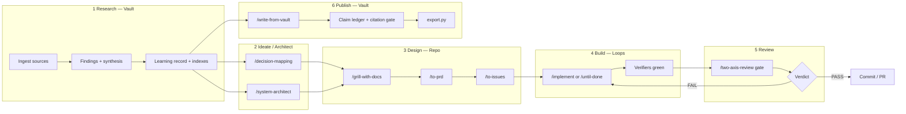

# Optimal Brain Playbook

**How to use this stack for research + engineering** — from first install through building, reviewing, and publishing, with a persistent vault.

For architecture and credits, see [OPTIMAL-BRAIN.md](./OPTIMAL-BRAIN.md). For config file details, see [agents/brain.md](./agents/brain.md). When unsure which skill to run, use `/ask-brain`.

## Two layers, one system

| Layer | Where it lives | What it holds |
| ----- | -------------- | ------------- |
| **Global brain** | Obsidian vault | `Sources/` (PDFs), companion notes, synthesis, learning records, Context Index, Research Sessions, Findings, decision traces, `{ProjectFolder}/Personal Notes/`, `{ProjectFolder}/Context Graph.canvas` |
| **Project brain** | Your code repo | `CONTEXT.md`, ADRs, `.agent/context/` (loops, project overlay, issue tracker, decision maps, architecture sessions) |

Research compounds in the vault. Code ships in the repo. The context graph connects them.

### Consumer repo layout (`.agent/context/`)

Per-repo agent config lives under **`.agent/context/`** — not scattered `docs/agents/` folders. Setup skills write there; skills read `.agent/context/<file>` first and fall back to legacy `docs/agents/<file>`.

```text
.agent/context/
  knowledge-vault.md       # vault path + conventions   (personal, gitignored)
  project-context.md       # which vault notes apply here (personal, gitignored)
  loops.md                 # verifiers + stop rules
  issue-tracker.md
  triage-labels.md
  domain.md
  decision-maps/           # /decision-mapping artifacts
  architecture-sessions/   # /system-architect hubs
  decision-traces/         # optional engineering audits
```

Human-facing domain docs (`CONTEXT.md`, `docs/adr/`) stay at conventional locations. See `skills/productivity/setup-knowledge-vault/AGENT-CONTEXT-PATH.md`.

## Lite path (start here)

The same three steps as the [README quick start](../README.md#quick-start-lite-vault-memory-only):

1. Install, selecting at least `setup-knowledge-vault` and `research-from-vault`:

   ```bash
   npx skills@latest add chidiokoene/optimal-brain
   ```

2. In your agent, run **`/setup-knowledge-vault`** and point it at your Obsidian vault.
3. Ask: "research X using my vault". **`research-from-vault`** writes linked, sourced notes back into the vault; later sessions read them back.

That is the whole memory layer. Add the rest when you need it (below).

## Full setup

### 1. Install skills

```bash
npx skills@latest add chidiokoene/optimal-brain
npx skills@latest add davidondrej/skills   # optional: external research (research-and-web)
```

Select at minimum: `setup-optimal-brain`, `setup-agent-loops`, `setup-knowledge-vault`, `ask-brain`, `agent-loop`, `until-done`, `implement`, `two-axis-review`, `research-from-vault`, `write-from-vault`, `decision-mapping`, `system-architect`, `project-notes`, `vault-context-canvas`.

### 2. Load them in your agent

Install with **project scope** in your repo, then start a **fresh agent session** so the new skills are picked up. What the repo actually backs up (same as the [README compatibility table](../README.md#agent-compatibility)):

- **Cursor**: used during development. Skills appear as `/` commands in Agent chat; the `/loop` prompts here use Cursor's built-in `/loop`.
- **Claude Code**: supported via `.claude-plugin/plugin.json` (and `scripts/link-skills.sh` → `~/.claude/skills`), not separately tested. Skills appear as `/` commands; Claude Code also has a bundled `/loop`.
- **Codex, Copilot, other Agent-Skills harnesses**: untested. Skills are plain `SKILL.md` folders; if your agent has no `/` menu, ask for the skill by name ("use the two-axis-review skill").

### 3. Run the setup skills (once per repo)

In order:

1. **`/setup-optimal-brain`** — issue tracker, triage labels, `CONTEXT.md` / ADR layout → `.agent/context/` (optionally create `architecture-sessions/`)
2. **`/setup-agent-loops`** — test/lint commands, stop rules, edit scope → `.agent/context/loops.md`. Optionally add `/two-axis-review` as a loop gate.
3. **`/setup-knowledge-vault`** — vault path, learning records, context graph, research capture folders → `.agent/context/knowledge-vault.md` + `.agent/context/project-context.md`

Have your Obsidian vault path ready for step 3.

Each setup skill ends with **commit guidance**. It adds a `# optimal-brain (personal)` block to `.gitignore` covering `.agent/context/knowledge-vault.md`, `.agent/context/project-context.md`, and `.scratch/`, because those hold your machine's vault paths. Commit the rest of `.agent/context/`, the skills block in `AGENTS.md`/`CLAUDE.md`, `CONTEXT.md`, and `docs/adr/`. On a team, commit `.agent/context/knowledge-vault.example.md` with placeholder paths and have each teammate copy it. Details: `skills/productivity/setup-knowledge-vault/AGENT-CONTEXT-PATH.md`.

### 4. Verify

- Your agent lists `/ask-brain`, `/setup-optimal-brain`, `/two-axis-review`, etc. (type `/`, or ask "which optimal-brain skills are installed?")
- Run `/ask-brain` and ask: "I'm starting a research + coding project — what flow should I use?"

## End-to-end workflow



Phases run in this order for a feature, but **Publish** can start from any point where the vault holds enough research.

### Phase 1 — Research

**Goal:** Turn PDFs, notes, and web material into durable knowledge the agent reuses while coding and writing.

#### Add sources (PDFs) to the vault

Agents read files under the vault path in `.agent/context/knowledge-vault.md`. Obsidian does **not** need to be running — only the folder on disk matters. Do **not** put large PDFs in the code repo unless you intend that.

1. Confirm the vault root after `/setup-knowledge-vault` (absolute path in `.agent/context/knowledge-vault.md`).
2. Create `{VAULT}/Sources/` if it does not exist.
3. Drop PDFs into `Sources/`.
4. Add a companion note next to each PDF, e.g. `Paper Note.md`, with `[[Paper.pdf]]` (or `![[Paper.pdf]]` to embed in Obsidian) plus key extracts or annotations.
5. Ingest with the agent (companion notes + learning records):

```
/until-done Ingest new sources in the vault under Sources/. For each PDF, create or update a companion note with key extracts and insights. Emit a vault learning record for each non-trivial insight. Update relevant Index notes. Stop when all new material has a companion note and at least one learning record per major source, or a stop rule fires.
```

Recipe: [ingest-sources-to-learning-records.md](../skills/productivity/setup-knowledge-vault/recipes/ingest-sources-to-learning-records.md)

**Vault only** (you already have sources):

```
/until-done Research "topic X" using only sources in my vault. Create session hub + finding notes per RESEARCH-CAPTURE-FORMAT.md. Produce synthesis + learning record + update Context Index and Research Index. Stop when all exist with wikilinks per `.agent/context/knowledge-vault.md`.
```

**External → vault → synthesize** (need fresh material):

```
/until-done Research "topic X" using external research tools. Fetch papers/posts/videos, save to vault with companion notes, capture findings (session hub + Findings/), synthesize into wikilinked note + learning record. Stop when capture format complete per RESEARCH-CAPTURE-FORMAT.md.
```

Recipe: [ingest-external-research-to-vault.md](../skills/productivity/setup-knowledge-vault/recipes/ingest-external-research-to-vault.md)

**Deep learning over weeks:** `/teach "topic X"` — bridged learning records land in the vault when configured.

**After significant research:** update `.agent/context/project-context.md` to link vault notes that apply to this project.

**Personal notes and visual graph:**

- **`/project-notes`** — your reflections → `{ProjectFolder}/Personal Notes/` in the vault
- **`/vault-context-canvas`** — refresh the Obsidian JSON Canvas at `{ProjectFolder}/Context Graph.canvas` (open it in Obsidian)

### Phase 2 — Ideate and architect

Two optional on-ramps before design. Use one, both, or neither.

**Fog of war** (open questions that need research, prototypes, or grilling across sessions):

1. **`/decision-mapping`** (bootstrap) — grilling session → map at `.agent/context/decision-maps/<slug>.md`
2. **Resume** per ticket — Research tickets use `research-from-vault`; Prototype → `/prototype`; Grilling → `/grilling` + `/domain-modeling`
3. When the map is done → Phase 3 (or straight to `/to-prd`)

**Non-trivial system design** (multi-view: domain, data, security, NFR):

1. **`/system-architect`** — pick engagement (`discovery`, `as_is_review`, `target_design`, `migration`)
2. Session hub → `.agent/context/architecture-sessions/`
3. Confirm ADR drafts → write under `docs/adr/`
4. Hand off → **`/to-prd`** / **`/to-issues`**

Recipes: [system-architect/recipes/](../skills/engineering/system-architect/recipes/). For code-only deepening (shallow modules), use **`/improve-codebase-architecture`** instead.

### Phase 3 — Design (before coding)

1. **`/grill-with-docs`** — align on what you're building; build shared language in `CONTEXT.md` and ADRs. Say "consult the vault for X" to ground in prior research.
2. **Optional:** **`/prototype`** + **`/handoff`** — throwaway code to answer "will this work?"
3. **`/to-prd`** — turn the grilled thread into a PRD (multi-session builds)
4. **`/to-issues`** — split into vertical slices (independently implementable issues)

Keep steps 1–4 in **one context window** when possible. After `/to-issues`, start a **fresh session per issue**.

### Phase 4 — Build

For each issue:

1. Fresh agent session
2. **`/implement`** with issue + PRD, or:

```
/until-done Implement issue #N per the PRD. Stop when tests pass per `.agent/context/loops.md` (fallback: `docs/agents/loops.md`) and /two-axis-review returns PASS or PASS WITH NOTES.
```

The agent reads: `.agent/context/loops.md` → `.agent/context/project-context.md` → `CONTEXT.md` → vault Context Index.

**`/implement` ends with `/two-axis-review` before it commits** (Phase 5). A FAIL sends it back into the loop; you get the remaining minor/nit findings in the final brief.

**Knowledge gap mid-build:**

```
Research X using my vault before implementing. Ground the approach in vault sources listed in project-context.md.
```

**TDD-heavy work:** the agent reaches `/tdd` during loops when appropriate.

### Phase 5 — Review

**Goal:** a second, structured look before anything is committed or merged. Skill: [two-axis-review](../skills/engineering/two-axis-review/SKILL.md).

- **Two axes, kept separate:** *Standards* (does the diff follow the repo's written rules?) and *Spec* (does it do what the issue/PRD asked?). They run in parallel subagents where the agent supports them, sequentially otherwise.
- **Cross-cutting checks:** correctness, security, tests, design ([CHECKS.md](../skills/engineering/two-axis-review/CHECKS.md)).
- **Findings** are conventional comments ranked `blocker` > `major` > `minor` > `nit`, each with `file:line` and evidence ([FINDINGS-FORMAT.md](../skills/engineering/two-axis-review/FINDINGS-FORMAT.md)).
- **Verdict:** **FAIL** (any blocker, or a major on Spec/Security) · **PASS WITH NOTES** (majors elsewhere, minors, nits) · **PASS** (nits at most).
- **As a loop gate** (`/implement`, `agent-loop`, `/until-done`): FAIL counts as a failing verifier; blocker/major findings become the next fix list; each re-review is an iteration; the same blocker surviving 2 fixes stops the loop. It never pushes, merges, or posts comments.
- **Vault:** review decisions (a tradeoff accepted, a spec ambiguity resolved) can be logged as decision traces.

Run it yourself on any branch: "review since main". Worked example: [two-axis-review/examples/](../skills/engineering/two-axis-review/examples/).

### Phase 6 — Publish

**Goal:** turn what the vault learned into an article, memo, or post where every claim has a receipt. Skill: [write-from-vault](../skills/productivity/write-from-vault/SKILL.md). Work lives in vault `Drafts/<Title>/`.

1. **Fragments** — mine session hubs, Findings, and sources; skip superseded notes, hedge exploratory ones; interview you for your view; name the gaps ([FRAGMENTS.md](../skills/productivity/write-from-vault/FRAGMENTS.md)).
2. **Shape** — one arguable governing thought, SCQA opening, 2–5 supporting claims ([SHAPE.md](../skills/productivity/write-from-vault/SHAPE.md)).
3. **Beats** — written one at a time, each citing its source note ([BEATS.md](../skills/productivity/write-from-vault/BEATS.md)).
4. **Verify** — the citation gate: every claim maps to a [claim ledger](../skills/productivity/write-from-vault/CLAIM-LEDGER.md) row with existing, non-superseded evidence, and wording never outruns strength.
5. **Export** — `scripts/export.py` writes `Drafts/<Title>/export/<slug>.md` plus `EXPORT-REPORT.md` ([EXPORT.md](../skills/productivity/write-from-vault/EXPORT.md)):

| Style | For |
| ----- | --- |
| `footnotes` (default) | GitHub, dev.to, Hugo/Jekyll/Astro blogs |
| `links` | Substack (render to HTML, paste rich text), Medium, email |
| `pandoc` | `pandoc --citeproc` → PDF/DOCX, academic venues |

`EXPORT-REPORT.md` flags unresolved links/embeds, cited or ledger evidence that is superseded/exploratory/expired, and notes with no public `url:`. Clear every flag before publishing; superseded or missing evidence sends you back to step 4. Publishing itself is yours; the agent never posts.

Worked example: [write-from-vault/examples/](../skills/productivity/write-from-vault/examples/).

## Copy-paste prompts

**Ingest new PDFs under Sources/:**

```
/until-done Ingest new sources in the vault under Sources/. For each PDF, create or update a companion note with key extracts and insights. Emit a vault learning record for each non-trivial insight. Update relevant Index notes. Stop when all new material has a companion note and at least one learning record per major source, or a stop rule fires.
```

**Link research to this project:**

```
Update `.agent/context/project-context.md` to include [[My Synthesis Note]] as exploratory design input for this project.
```

**Research then code:**

```
/until-done Research "chunking strategies for academic PDFs" from my vault until synthesis + learning record exist. Then propose an implementation plan grounded in that synthesis before writing code.
```

**System architecture (target design):**

```
/system-architect target_design for hybrid RAG over vault PDFs. Write session hub under .agent/context/architecture-sessions/. Propose ADR drafts. Stop when synthesis + next step toward /to-prd exist. Do not implement code.
```

**Build with vault grounding:**

```
/until-done Implement the retrieval module for issue #4. Before coding, consult vault sources in `.agent/context/project-context.md`. Stop when tests pass per `.agent/context/loops.md`.
```

**Review a branch:**

```
/two-axis-review since main. Spec: issue #42. Report Standards and Spec separately, rank findings blocker → nit, end with the verdict and the one change that would flip a FAIL.
```

**Loop with a review gate:**

```
/until-done Implement issue #42 per the PRD. After verifiers in `.agent/context/loops.md` pass, run /two-axis-review in gate mode against main with the issue as spec. Treat FAIL as a failing verifier and fix blocker/major findings. Stop on PASS / PASS WITH NOTES or a stop rule; list remaining minor/nit findings. Do not push.
```

**Write an article from the vault:**

```
/write-from-vault Why do coding agents forget, and what fixes it? Reader: developers using a coding agent daily. Form: ~1200-word blog post. Use only non-superseded notes; hedge exploratory ones. Stop after the citation gate passes.
```

**Export for dev.to / Substack:**

```
Export Drafts/Why Agents Forget with write-from-vault's export script: --style footnotes for dev.to, then --style links for Substack. Show me EXPORT-REPORT.md and walk me through every flag. Don't publish anything.
```

**Design a custom workflow:**

```
/setup-agent-loops Design a custom workflow: a weekly review of my vault's new findings. Use the design-custom-workflow recipe and write the spec from workflow-spec-template.md, including verifiers, a push-right checkpoint, guardrails, and 3 eval cases.
```

Recipe: [design-custom-workflow.md](../skills/engineering/setup-agent-loops/recipes/design-custom-workflow.md) · Example: [weekly-vault-review.md](../skills/engineering/setup-agent-loops/examples/weekly-vault-review.md)

**Full pipeline (external → vault → design):**

```
/until-done Fetch recent papers on hybrid RAG, save to vault Sources/ with companion notes, synthesize, update Context Index, then propose architecture in docs/adr/. Stop when synthesis note exists and a one-page architecture outline is in docs/adr/.
```

**Maintenance (weekly):**

```
/loop 7d Run the maintain-context-graph recipe from setup-knowledge-vault. Update Context Index and reconcile project-context.md for stale links. Optionally refresh vault-context-canvas.
```

`/loop` (Cursor, Claude Code) takes `s`/`m`/`h`/`d` intervals, so weekly is `7d`. It only runs while that agent session stays open; for a dependable weekly run, use your agent's scheduler/automations or just run the prompt yourself each week. Recipe: [maintain-context-graph.md](../skills/productivity/setup-knowledge-vault/recipes/maintain-context-graph.md)

## Example: research-heavy app (knowledge graph + chatbot)

| Step | Action | Skill / artifact |
| ---- | ------ | ---------------- |
| 1 | Drop PDFs into vault `Sources/` | Manual |
| 2 | Companion notes (`[[Paper.pdf]]`) + ingest | `/until-done` + ingest-sources recipe |
| 3 | Synthesize literature (session hub + Findings) | `research-from-vault` / `/until-done` |
| 4 | Personal reflection | `/project-notes` |
| 5 | Link synthesis in project overlay | Update `project-context.md` |
| 6 | Multi-view target design (if non-trivial) | `/system-architect` |
| 7 | Refresh Obsidian context graph | `/vault-context-canvas` |
| 8 | Grill system design grounded in vault | `/grill-with-docs` |
| 9 | PRD + issues | `/to-prd` → `/to-issues` |
| 10 | Implement first slice | `/implement` or `/until-done` |
| 11 | Agent unsure about approach | "research X from vault" |
| 12 | Review gate before commit | `/two-axis-review` (inside `/implement`) → PASS / PASS WITH NOTES |
| 13 | Implement remaining slices | Fresh session per issue, each gated by `/two-axis-review` |
| 14 | Write up what you learned | `/write-from-vault` → claim ledger → citation gate |
| 15 | Export and publish | `export.py --style footnotes` (dev.to) / `links` (Substack); clear EXPORT-REPORT flags |
| 16 | Vault hygiene | Weekly maintain-context-graph (`/loop 7d` or scheduled) |

## Daily and weekly habits

| When | Do this |
| ---- | ------- |
| **Start a coding session** | Agent reads `.agent/context/project-context.md` + relevant vault notes |
| **After dropping PDFs** | Companion note + ingest recipe (then research if needed) |
| **After reading a paper** | PDF + companion note → finding notes + synthesis → learning record → Context Index + Research Index |
| **Before a big system change** | `/system-architect` (or `/decision-mapping` if fog of war) |
| **Before a big feature** | `/grill-with-docs` |
| **During / after research** | `/project-notes`; optionally `/vault-context-canvas` |
| **During build** | `/until-done` with explicit done signal |
| **Before commit / merge** | `/two-axis-review` (automatic inside `/implement`) |
| **When a topic has enough notes** | `/write-from-vault`, then export |
| **A chore keeps recurring** | `/setup-agent-loops` → design a custom workflow |
| **Weekly** | maintain-context-graph recipe (`/loop 7d` or your scheduler); re-run export on published drafts whose sources changed |
| **Unsure what to run** | `/ask-brain` |

## Agent read order

When research and code intersect:

1. `.agent/context/knowledge-vault.md` (fallback: `docs/agents/knowledge-vault.md`)
2. `.agent/context/loops.md` (fallback: `docs/agents/loops.md`)
3. `.agent/context/project-context.md` (fallback: `docs/agents/project-context.md`)
4. Vault Context Index
5. Wikilinked notes from the vault

## Rules of thumb

1. **Vault first for knowledge, repo first for action** — research lives in Obsidian; code decisions live in ADRs and `CONTEXT.md`.
2. **Never leave research only in chat** — capture session hub + finding notes in the vault (see RESEARCH-CAPTURE-FORMAT.md).
3. **Exploratory vault notes ≠ implementation truth** — review before coding; `confidence: exploratory` means design input only.
4. **One issue, one fresh session** — after `/to-issues`, implement slices separately.
5. **Grill before you build** — `/grill-with-docs` prevents misalignment; use `/system-architect` when multi-view design is needed.
6. **Loops need real verifiers** — `/setup-agent-loops` must match your actual test/lint commands.
7. **Review before you commit** — `/two-axis-review` keeps Standards and Spec apart; a FAIL is a failing verifier, not a suggestion.
8. **No claim without a source note** — every claim in an article maps to a claim-ledger row; superseded evidence is never cited, exploratory evidence is always hedged.
9. **Export, don't hand-edit** — fix the vault draft and re-run `export.py`; never edit `export/` by hand.

## Shortest path (today)

1. **Lite path**: install → `/setup-knowledge-vault` → "research X using my vault"
2. When you want to build: run `/setup-optimal-brain` and `/setup-agent-loops` (see Full setup)
3. `/grill-with-docs` (or `/system-architect` if the design is non-trivial) → `/to-issues`
4. `/implement` the first slice; it ends with `/two-axis-review`
5. When the vault has enough on a topic: `/write-from-vault`, then export

## Related

- [OPTIMAL-BRAIN.md](./OPTIMAL-BRAIN.md) — architecture, Matt comparison, Karpathy distinction
- [agents/brain.md](./agents/brain.md) — layers, quickstart, config files
- [agents/knowledge-vault.md](./agents/knowledge-vault.md) — vault rules and examples
- [skills/engineering/ask-brain/SKILL.md](../skills/engineering/ask-brain/SKILL.md) — full routing tables
- [skills/engineering/system-architect/](../skills/engineering/system-architect/) — orchestrator + [recipes/](../skills/engineering/system-architect/recipes/)
- [skills/productivity/project-notes/SKILL.md](../skills/productivity/project-notes/SKILL.md) — personal notes in vault
- [skills/productivity/vault-context-canvas/SKILL.md](../skills/productivity/vault-context-canvas/SKILL.md) — Obsidian JSON Canvas context graph
- [setup-knowledge-vault/recipes/](../skills/productivity/setup-knowledge-vault/recipes/) — ingest, research, maintain
- [setup-agent-loops/recipes/](../skills/engineering/setup-agent-loops/recipes/) — implement-issue, build-test-fix, design-custom-workflow
- [skills/engineering/two-axis-review/SKILL.md](../skills/engineering/two-axis-review/SKILL.md) — two-axis review, severities, loop gate
- [WITH-GSTACK.md](./WITH-GSTACK.md) — using this pack alongside gstack (name collisions, which skill to prefer)
- [skills/productivity/write-from-vault/SKILL.md](../skills/productivity/write-from-vault/SKILL.md) — vault → sourced article, claim ledger, [export](../skills/productivity/write-from-vault/EXPORT.md)
